# Table of Contents
1. [Introduction](#introduction)
2. [Background](#background)
3. [List of Debug Commands](#list-of-debug-commands)
4. [Tutorial](#tutorial)
5. [Testing](#testing)
6. [Updates](#updates)
7. [FAQ](#faq)
8. [Downgrading SteamVR](#downgrading-steamvr)
9. [Other Methods](#other-methods)

# Introduction
Those of you using OLED headsets with SteamVR might've noticed that black pixels don't actually turn off (unlike what you'd normally expect from OLED displays). This is due to a "black clamp" SteamVR uses to prevent "black smear".

This guide details a few ways to disable the black clamp, and restore some removed debug commands.

# Background
First, I'd like to give some background information on
* What "true blacks" are
* Why they're not enabled by default
* Why you might want to enable them

**If you already know all this (or just don't care), feel free to skip to the [Tutorial](#tutorial) section.**

## OLED
OLED is a display technology that is fundamentally different from the LCDs found in most TVs and monitors. Generally, they boast better contrast ratios than their LCD counterparts, resulting in an image that looks more vibrant.

Many VR headsets utilize OLED (or Micro-OLED) displays. If you're unsure what kind of display your headset has, you can check using [this website](https://vr-compare.com/vr).

OLED displays are unique in that they don't have a backlight. Instead, each pixel emits its own light. This means you can completely turn off individual pixels, and they won't be emitting any light. This is what I mean when I say "true black".

## Black Smear
Although completely turning off black pixels allows for the deep blacks OLEDs are frequently praised for, it can also introduce an unwanted phenomenon known as "black smear". It looks a bit like black/purple trails around black regions of the screen when you move your head.

I won't get into the details of black smear here, so I'd recommended [this article](https://web.archive.org/web/20241203023317/http://doc-ok.org/?p=1966) for those interested in learning about it.

In order to prevent black smear, SteamVR implements a "black clamp" that prevents the headset's display from ever receiving a pixel with a color value of zero (true black). This means that even if your game is outputting a frame with true black pixels, SteamVR is actively swapping out those pixels for slightly brighter ones before the image reaches your headset.

Here's an image that attempts to convey this (you'll need a bright OLED display to see the difference):

* The left side is true black: pixels with a color value of `#000000`. This is what your game is rendering.
* The right side is almost (but not quite) black: pixels with a color value of `#030303`. This is what's displayed on your headset with the black clamp enabled.

This by itself isn't a huge deal. You lose out on some of the "inky blacks" OLEDs are known for, but it's not super noticeable. Where it becomes a bigger problem is when we introduce another phenomenon in OLED display technology, known as "mura".

## Mura
Mura is a visible phenomenon that arises due to physical variances between pixels, where each pixel is actually emtting a slightly different color at a slightly different brightness, even if they're all supposed to be the same color.

Normally, mura isn't very noticeable. But normally, screens aren't inches away from our eyes!

Although headsets ship with mura correction from the factory, mura can still be noticeable (with severity depending on the specific headset), especially when you're looking at a large region of a single color. It feels as though there's a static, noisy texture overlayed on top of your game.

[This video](https://www.youtube.com/watch?v=M8sCcUuZAEU) describes mura in detail, for those interested.

Because of mura, the difference between true black pixels and almost-black pixels looks more like this (you might need to zoom in):

* The left side is true black: pixels with a color value of `#000000`. Since the pixels are off, they all look exactly the same. There is no mura, since none of the pixels are emitting any light.
* The right side is almost (but not quite) black: pixels with a color value of `#030303`. Now with (exaggerated) simulated mura.

## To clamp, or not to clamp?
Consequently, using a black clamp comes with notable trade-offs. It prevents (or at least reduces) black smear, at the cost of true blacks, and thus causes noticeable mura in dark scenes.

In some older versions of SteamVR, such as 1.5.6, a button existed in the Debug Commands window labeled **black_clamp_toggle**. This allowed you to enable/disable SteamVR's black clamp at will, so you could decide for yourself whether you wanted it enabled.

In 1.5.7, however, black_clamp_toggle (and many other debug commands) were removed, and (as of SteamVR 2.19.5) were never re-added. The black clamp is forced on, and there's no official way to disable it.

This guide will detail a few methods to disable the black clamp, and restore these removed debug commands, in modern versions of SteamVR.

# List of Debug Commands
At the time of writing, the latest public version of SteamVR is 2.18.4.

These are the debug commands availible by default in 2.18.4:
* application_render_model_visibility_toggle
* application_throttling_frame_count_cycle
* application_throttling_toggle
* async_mode_running_start_toggle
* async_mode_toggle
* backbuffer_debug_text_toggle
* camera_room_view_toggle
* clear_render_model_cache
* collision_bounds_center_marker_toggle
* collision_bounds_ground_perimeter_toggle
* collision_bounds_play_space_toggle
* collision_bounds_style_cycle
* debug_counter_increment
* debug_mips
* disable_theater_mode
* dump_systemlayer_textures
* frame_wait_throttle_toggle
* gpu_profiler_capture
* grid_mode_cycle
* ipd_offset_decrement
* ipd_offset_increment
* latency_testing_toggle
* legacy_mirror_view_cycle
* legacy_mirror_view_toggle
* motion_vector_debug_mode_cycle
* motion_vector_debug_mode_cycle_backwards
* motion_vector_debug_mode_toggle
* motion_vector_fixups_toggle
* motion_vector_nvopticalflow_quality_cycle
* motion_vector_nvopticalflow_toggle
* quick_reset_room_setup
* reflection_map_reload
* screenshot_all_request
* screenshot_request
* seated_and_standing_position_reset
* seated_position_reset
* set_angular_debug_mode
* set_eye_tracking_debug_mode
* shaders_force_reload
* simulate_3dof_toggle
* single_frame_stepping_request
* system_dashboard_toggle
* toggle_perf_graph
* toggle_supersample_filtering
* tracking_debug_mode_cycle
* trigger_renderdoc_capture
* vsync_to_photons_big_decrement
* vsync_to_photons_big_increment
* vsync_to_photons_decrement
* vsync_to_photons_increment

These are the new debug commands accessible after performing the **Method 2** process outlined in this guide:
* black_clamp_toggle
* channel_mode_black
* channel_mode_blue
* channel_mode_cyan
* channel_mode_green
* channel_mode_magenta
* channel_mode_red
* channel_mode_white
* channel_mode_yellow
* ghost_correction_decrement
* ghost_correction_increment
* ghost_correction_toggle
* hmd_debug_down
* hmd_debug_up
* mura_correction_toggle
* read_fsr_settings
* rolling_reprojection_toggle
* send_hmd_debug_request
* simulate_hdcp_error
* user_brightness_decrement
* user_brightness_increment

# Tutorial
## Choosing a method
First, you'll need to decide which method you'd like to use. Both of these methods involve modifying vrcompositor.exe.

### Method 1 - Forcibly disable the black clamp
* This method forces SteamVR to skip the application of the black clamp.
* Choose this option if you **never** want to use the black clamp.
* No debug comands are added.

### Method 2 - Restore removed debug commands
* This method restores the debug commands that were removed in 1.5.7, including black_clamp_toggle.
* Choose this option if you'd like to easily compare having the black clamp on vs off, or if you want to tinker with the extra debug commands it adds.
* You'll have to click black_clamp_toggle (or press the 'k' key) in the Debug Commands window whenever you want to enable/disable the black clamp.
* The black clamp **always starts enabled** when SteamVR is launched.

These methods are **not** mutually exclusive. If you want the black clamp permanently disabled, AND you'd like to access the new debug commands, just perform both methods. Do note, however, that the black_clamp_toggle command won't do anything.

## Finding your SteamVR version
Next, find your SteamVR version. This is displayed at the top of the SteamVR window, above the icons for your headset/controllers.

## Finding your offsets
Reference [this table](offsets.md) to find the offsets pertaining to your version of SteamVR and the method(s) you've chosen. All offsets are for the 64-bit version of vrcompositor.exe and are written in hexadecimal.

If your version of SteamVR isn't listed here, you'll need to download a version of SteamVR with known offsets. Refer to [Downgrading SteamVR](#downgrading-steamvr) for details.

## Modifying vrcompositor.exe
Once you have your offset(s), you'll use them to modify vrcompositor.exe.
You can either do this manually with a hex editor, or use a script.

### Using the script
Download [unclamp.cmd](unclamp.cmd) and [Set-Bytes.ps1](Set-Bytes.ps1) and place them in the same directory. Double-click unclamp.cmd to run it. The script will ask you for your the location of your SteamVR folder, which method(s) you'd like to apply, and what the offsets are for each method you've selected.

Here's a screenshot of the script in action:

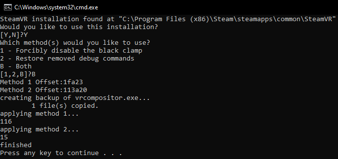

The numbers printed after **applying method 1...** and **applying method 2...** are the original values (in decimal) of the first byte replaced while applying each method. These should always be:
* **116** (**0x74**) for Method 1
* **15** (**0x0F**) for Method 2

### Using a hex editor
I'll be using [Visual Studio Code](https://code.visualstudio.com/download) and its [Hex Editor](https://marketplace.visualstudio.com/items?itemName=ms-vscode.hexeditor) extension.

### Setup
* Navigate to your SteamVR folder (you can do this from your Steam library by **right-clicking SteamVR -> Manage -> Browse local files**)
* Navigate to **SteamVR\bin\win64**
* Make a copy of **vrcompositor.exe**, in case you want to revert this mod later
* Open **vrcompositor.exe** in your hex editor

### Applying Method 1 (Forcibly disable the black clamp)
1. Go to your **Method 1** offset (in vscode, press **ctrl+g**, type **0x**, paste your offset, then press the **enter** key)

	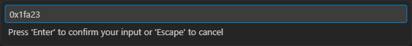

2. Your text cursor should jump to the specified offset. The next byte (where your cursor is) should be **74**

	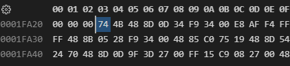

3. Replace this byte with **EB**. Make sure you are overwriting the byte, not inserting a new one (in vscode, you'll need to press the **insert** key to switch to overwrite mode)

	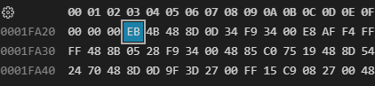

4. Save the file (in vscode, use **File -> Save**)

### Applying Method 2 (Restore removed debug commands)
1. Go to your **Method 2** offset (in vscode, press **ctrl+g**, type **0x**, paste your offset, then press the **enter** key)

	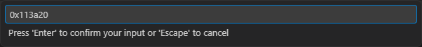

2. Your text cursor should jump to the specified offset. The next two bytes (starting where your cursor is) should be **0F 84**.

	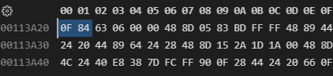

3. Replace each of the next <ins>six</ins> bytes with **90**. Make sure you are overwriting the bytes, not inserting new ones (in vscode, you'll need to press the **insert** key to switch to overwrite mode)

	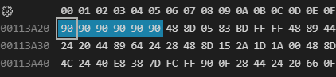

4. Save the file (in vscode, use **File -> Save**)

### Final steps
#### Method 1
The next time you launch SteamVR, the black clamp will be forcibly disabled. No additional steps are necessary.

#### Method 2
The next time you launch SteamVR, **click 3 Lines -> Developer -> Debug Commands**, and you'll see many new debug commands, including black_clamp_toggle. **You must have a VR headset connected, otherwise the Debug Commands window will appear empty.**

Simply click the **black_clamp_toggle** button (or press **k** on your keyboard) to toggle the black clamp on or off.

# Testing
Once you've finished the above tutorial, you should test your headset with the black clamp disabled.
1. Find a pitch black home environment (I used [this one](https://steamcommunity.com/sharedfiles/filedetails/?id=684891416))
2. Visit it (in SteamVR Home, click **ENVIRONMENTS**, select it, then click **Visit On My Own**)
3. Look around. You shouldn't see any mura
4. Find a very dark area in an environment or game. The area should have some regions of black, and some regions of non-black (I used the Nova Prospekt level in *Half-Life 2: VR Mod*)
5. Move your head around quickly, and focus on the edges of the black regions. You'll likely notice some black smear

If the black smear is too distracting, you can re-enable the black clamp:
* If you used Method 1, you'll need to revert vrcompositor.exe back to its original state. Use the copy made earlier (either by you or the script). If you don't have a copy, verify SteamVR's files to re-download vrcompositor.exe:

	**Right-click SteamVR in your library -> Properties... -> Installed Files -> Verify integrity of tool files**

* If you used Method 2, just click **black_clamp_toggle** again

# Updates
Because these methods work by modifying vrcompositor.exe, their changes will be reverted whenever vrcompositor.exe gets replaced with a newer version. Unfortunately, this happens every time SteamVR receives an update.

You can disable automatic updates:

**Right-click SteamVR in your library -> Properties... -> Updates -> Wait until I launch the game**

But this will only delay updates until you next launch SteamVR through Steam.

Therefore, to keep using this mod after an update is released, you have three options:
1. Avoid launching SteamVR directly through Steam. Don't launch SteamVR from your library, or click the **Enter VR Mode** button in the top right, as this will cause SteamVR to update. Instead, launch SteamVR by either running **SteamVR\bin\win64\vrstartup.exe**, or click **Play** on a **VR-only** game in your library.
2. Back up your entire SteamVR folder before an update, update SteamVR, then replace the new/updated version with your old/modded version. As far as Steam's concerned, you're up to date.
3. Update SteamVR, then go through this modding process again. You'll need the offsets for the new version.

# FAQ
## Won't disabling the black clamp re-introduce black smear?
Yes, but depending on the person (**and the headset!**) it might be a worthy trade-off.

So far, I've tested this with 3 headsets: HTC VIVE (2016), HTC VIVE (2017), HTC VIVE Pro (2018). For the 2017 VIVE and the VIVE Pro, the black smear was noticeable, but it wasn't super distracting during normal gameplay. For the 2016 VIVE, the black smear was **extremely** noticeable, and I personally wouldn't bother disabling the black clamp on it.

I'm not entirely sure why this would be (maybe variance in individual panels, maybe my pre-owned 2016 VIVE was heavily used or improperly stored), but it is something to note.

## Does the black clamp affect LCD headsets?
No. Tested with both a Valve Index and a VIVE Cosmos Elite.

## Why were these debug commands removed?
The only official acknowledgement is [this comment](https://github.com/ValveSoftware/openvr/issues/1167#issuecomment-517775762) from a Valve developer.

# Downgrading SteamVR
Firstly, if your desired version is only one version behind the current public version, you can easily switch to it:

**Right-click SteamVR in your steam library -> Properties... -> Game Versions & Betas -> previous**

The **previous** branch is just the last public (i.e. "non-beta") build of SteamVR.

Otherwise, you'll need to download your desired version manually. To begin, find the patch notes for the version of SteamVR you wish to download [here](https://store.steampowered.com/news/app/250820). Take note of the date/time the update was released.

To download older versions of SteamVR, we'll be using the **Steam Console** and its **download_depot** command.

## Accessing the Steam Console
1. Right-click your Steam shortcut (either on your Desktop or in your Start Menu folder)
2. Click **Properties**
3. At the end of the **Target** text box, add **-console**
4. Fully shut down Steam (**right-click Steam in your taskbar -> Exit Steam**)
5. Launch Steam by double-clicking the shortcut you just modified
6. You should now have an additional tab named **CONSOLE** at the top of the Steam window. Click this tab to open the Steam Console

## download_depot
The syntax of the download_depot command is as follows:
**download_depot \<appid\> \<depotid\> \[\<target manifestid\>\]**

### appid
For SteamVR, this is **250820**

### depotid
A depot is essentially a collection of files that need to be downloaded to install a game/app on Steam.

There are **three** relevant depots for downloading a copy of SteamVR on Windows:
* **250821** (OpenVR Win32)
* **250824** (OpenVR Content)
* **250827** (OpenVR Content 2)

You'll need to download all three of these.

### target manifestid
This is essentially the "version" of the depot you are downloading. It's dependent on both the depot you are downloading, and the version of SteamVR you are attempting to download.

Visit [SteamDB](https://steamdb.info/app/250820/depots/), click the depot id for the depot you are interested in, then click **Manifests** to view the list of manifests ids.

Note: To view more than the latest **10** manifest ids, you'll need to log in with your Steam account.

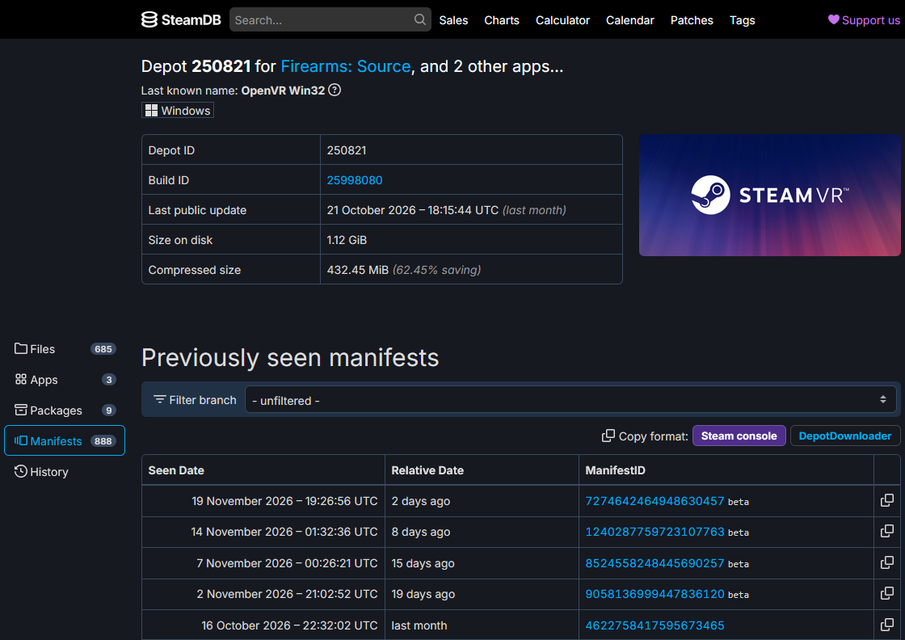

The **Seen Date** of the manifest ids in SteamDB should (roughly) match up with the date listed in the patch notes for each SteamVR version. If there's no matching date (which is often the case for depot **250827**, as it doesn't get updated frequently), use the newest manifest with a date that comes **before** the dates of the other manifests.

For example, SteamVR 2.18.4 was released for the beta branch on 16 October 2026 (and later moved to the public branch on 21 October 2026)
The relevant manifests are:
* depot **250821** manifest **4622758417595673465** (Seen Date: 16 October 2026)
* depot **250824** manifest **3693738476548293851** (Seen Date: 16 October 2026)
* depot **250827** manifest **4144201462816264829** (Seen Date: 24 June 2026)

## Downloading depots
Once you have the relevant manifest ids for the SteamVR version you wish to download, you'll need to use the download_depot command in the Steam Console. For this, just reference the download_depot syntax above.

Alternatively, SteamDB has a handy feature that allows you to copy the necessary command with a single click:
* Ensure **Copy format** is set to **Steam console**

	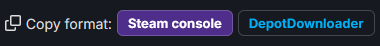

* Click the copy button next to manifest you need

	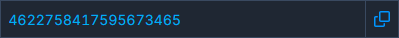

For example, to download SteamVR 2.18.4, you'd run the following commands:
* **download_depot 250820 250821 4622758417595673465**
* **download_depot 250820 250824 3693738476548293851**
* **download_depot 250820 250827 4144201462816264829**

If you encounter an error when attempting to download, try fully shutting down Steam, restarting it, and running the command again.

When a depot finishes downloading, the console will print a message telling you where to find the downloaded files. For SteamVR, this will be **Steam\steamapps\content\app_250820\\**.

## Replacing your current installation
The last step is to replace your current SteamVR installation folder.
* Rename your current SteamVR folder to something else, in case you ever want to switch back to the current version of SteamVR
* Create a new folder named **SteamVR**, and move the files from each downloaded depot into this new folder
* Whenever you want to switch between versions, just rename your folders. **The active version is always the folder named SteamVR**

# Other Methods
I've decided to document some methods others have come up with for enabling true blacks. Each of these has notable downsides, but they might be valid options depending on your specific needs.

## Boosting contrast with GPU driver settings
This method works by disabling direct mode, then boosting the contrast of the headset's display via graphics driver settings.

It seems that in the current public build of SteamVR, **only the original HTC VIVE can be run outside of direct mode**. The HTC VIVE Pro can only be run out of direct mode in older versions, such as 1.5.7.

Note: I have a NVIDIA graphics card, so this tutorial will use the NVIDIA Control Panel. If you have an Intel or AMD GPU, you'll need to find the equivalent settings yourself.

1. Launch SteamVR
2. **3 Lines -> Settings**
3. Under **Advanced Settings** in the bottom left, set the toggle to **Show**
4. **Developer -> DISABLE DIRECT MODE**, then click **Yes** to restart SteamVR
5. Open NVIDIA Control Panel
6. **Display -> Adjust desktop color settings**
7. Click the display belonging to your headset (probably named **HTC Corporation...**)
8. Move the contrast slider up one notch from 50% (this will probably be 52% or 53%)

	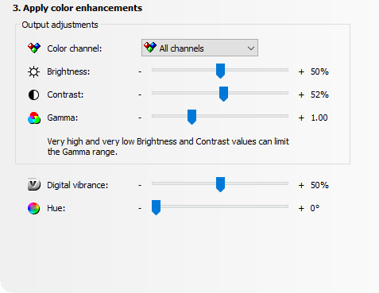

Pros:
* Persists across updates

Cons:
* Limited headset support (in the current public build of SteamVR, this method only works with the HTC VIVE)
* You must run SteamVR outside of direct mode. This can cause many issues/annoyances, such as:
	* Accidentally moving your mouse cursor into the headset's view (outside of direct mode, Windows treats the headset as a separate monitor)
	* The compositor window ocassionally getting un-focused or un-fullscreened, making the headset unusable until you manually click the window to re-focus it
	* The headset display might be automatically set as your primary monitor, making newly launched programs show up there instead of on your actual monitor
	* Sometimes, the headset's screens stay on even when SteamVR is closed and you aren't wearing it. **This has the potential to cause burn-in!**
	* According to the SteamVR settings tooltip, disabling direct mode also increases latency
* Technically, since the contrast slider affects all colors (not just black), you are also slightly altering the colors of your game. This isn't really noticeable though

## Using SteamVR 1.5.6
**1.5.6** is the last official version of SteamVR where these extra debug options are freely available.

You can download it using the steps outlined above (under [Downgrading SteamVR](#downgrading-steamvr)).
The manifest ids you'll need are:
* depot **250821** manifest **4954501447188426936**
* depot **250824** manifest **6615142569986989078**
* depot **250827** manfiest **8620245067706755731**

Pros:
* No hex-editing required, just download and replace your current SteamVR installation

Cons:
* Incompatible with some newer games (*Half-Life 2: VR Mod* wouldn't launch with this version, and I'd imagine other games might have trouble too)
* Incompatible with newer VR hardware (SteamVR displayed a generic error message when I tried to use a VIVE Cosmos Elite. I'd be surprised if anything released after the Valve Index works with a version this old)
* Older dashboard UI with fewer features (you can't launch games through the dashboard, and you can't interact with your desktop)
* You'll have the same problem with updates that the hex-editing methods have (see the [Updates](#updates) section for workarounds)

## Modifying the headset's black_clamp value
Lastly, a method that seems like it should work (but **doesn't**).

In **SteamVR\tools\lighthouse\bin\win64\\**, there's a program named **lighthouse_console.exe**. This program allows you to download/upload the configuration file used by your headset. This config file contains values used for things like barrel distortion correction, mura correction, and lighthouse tracking.

Under the **display_gc** section, there's a variable named **black_clamp**, initially set to a value of **0.0117647061124444**.

Unfortunately, changing this value and uploading the modified config to the headset (using the **uploadconfig** command) **doesn't seem to have any effect**.